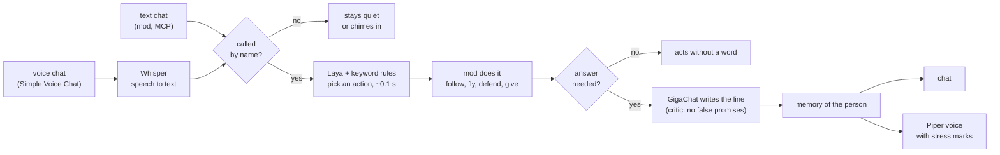
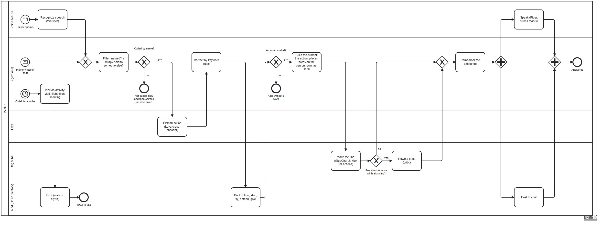

# persona-agent

**Pyhtun** — a home-loving hobbit who reluctantly supplies a flying wizard with fireworks — is an AI
character that plays Minecraft with real players. He hears the game's voice chat, decides what to
do in about a tenth of a second, answers out loud in his own voice, explores, remembers places and
people, and talks with other AI characters on the server.
The character himself — backstory, temper, speech — is in [docs/persona.md](docs/persona.md).

The design goal is **speed**: from the end of a player's phrase to the first sound of the answer
in about two seconds, most of it speech recognition.

## How it works



```
 game voice chat ──UDP───▶ voice/service.py ──(per player)──▶ Whisper large-v3-turbo ──▶ ┐
 game text chat ──MCP getRecentChat──────────────────────────────────────────────────────▶ ┤
                                                                                           ▼
                                       Go agent (cmd/agent)
   ┌───────────── decide ─────────────┐   ┌──── act ─────┐   ┌──────── speak ────────┐
   │ keyword rules (explicit verbs)   │   │ UnionClef    │   │ GigaChat-2 (fast)     │
   │ Laya: ru + en questions, ~100 ms │──▶│ via MCP:     │──▶│ GigaChat-2-Max for    │
   │ agreement + threshold            │   │ @follow,     │   │ "where/how" & actions │
   └──────────────────────────────────┘   │ @goto, flyTo │   │ critic: no false      │
                                          └──────────────┘   │ "I'm coming" promises │
                                                             └───────────┬───────────┘
                                                text chat ◀──────────────┤
                                     Piper (per sentence) ──▶ VB-Cable ──▶ game voice chat
```

- **Laya chooses, the LLM talks.** Laya (a fast non-autoregressive decision model) picks one of a
  few actions — wait, follow, stop, defend, bring rockets, lead home. Explicit verbs ("подойди",
  "замри", "крипер", "полетели") are caught by rules first; Laya handles the rest. The LLM is
  only asked for the words.
- **One GigaChat stream.** Replies go through a single worker; a newer reason to speak replaces
  a waiting one instead of queueing behind it.
- **Voice is per player.** UnionClef forwards every Simple Voice Chat packet tagged with the
  speaker's name, so speakers are separated without diarisation. The packets come as UDP
  datagrams, not over Py4J: nothing to connect or keep alive ([docs/voice-transport.md](docs/voice-transport.md)).
- **Shared-server manners.** The pathfinder mines only natural terrain and places nothing (fork
  tool `setBuildPolicy`; with the upstream mod, a no-break zone around home).

### The process in BPMN

One line from a player, from the voice or the chat to the answer, and what the bot does in the
quiet in between. Lanes are the parts that do the work: the voice service, the Go agent, Laya,
GigaChat and the mod. The source is [docs/pyhtun.bpmn](docs/pyhtun.bpmn) (opens in
[bpmn.io](https://demo.bpmn.io) or Camunda Modeler).



## What the character does

| Skill | How |
|---|---|
| answer by voice and chat | Whisper → rules + Laya → GigaChat → Piper, ~1.9 s end to end |
| follow / stop / lead home | UnionClef `@follow`, `@stop`, `@goto` |
| stay with companions, start conversations | idle turns: invite someone to a remembered place, or talk on a rotating topic |
| explore | chunk by chunk around home; surface map + sign text → `data/places.json` |
| remember people | `data/people/<nick>.md`: dated exchanges + short notes (summarised while quiet) |
| fly on an elytra | fork tool `flyTo`: equip, take off, climb on rockets, glide down near the target |
| creative and survival | game mode from `getGameState`; creative takes items from the creative tab |

## Flying

The character flies on elytra through the fork's pilot: normal flights, low-level, aerobatic
figures and routes round places, with plane-like landings. Modes, styles and safety, with diagrams:
[docs/elytra-pilot.md](https://github.com/alteralto/unionclef/blob/pyhtun/docs/elytra-pilot.md).

## Self-improvement loop

Every decision goes to `data/decisions.jsonl` (with a *repeat* flag when the same player asks
again within 30 s — a sign the decision missed). Overnight (`scripts/nightly.sh`):

1. `cmd/benchmine` takes new lines from the journal, weak-labels them with GigaChat-2-Max into
   `bench/laya_cases.auto.json`.
2. `cmd/layatune` searches the decision setup (rule, threshold) and asks the LLM to rewrite the
   option descriptions. The bench is split in half: weak labels only ever join the **train**
   half; the **test** half is hand-labelled.
3. The result is written to `data/laya_criteria.json` — which the agent loads at start — **only if
   it beats the current setup on the test half.** LLM rewrites that made things worse were
   rejected by this gate on the first runs.

First runs on 63 lines from a live session: Laya alone 66 % → with keyword rules 81 % → with a
tuned threshold 84 % on the test half (the rules were written having seen the whole bench, so
this is optimistic until new lines come in).

4. `cmd/simrun` plays a scripted scene with the real GigaChat and Laya against the simulated game
   and prints reply quality (length, repeats, gendered address) next to the timeline.

## Testing without the game

`internal/sim` stands in for the mod: the same MCP tools and JSON shapes (chat, `pathStatus`,
`getGameState`, `ExecuteCommand`, signs, creative items, elytra flights, inventory), plus fake
Laya and GigaChat servers. `internal/agent/sim_test.go` runs the real agent against it — follow,
fly to a player, stop mid-flight, game restart, full inventory, signs, upstream-mod fallbacks —
in about 15 seconds:

```bash
go test ./...
go run ./cmd/simrun                                              # fake models, instant
go run ./cmd/simrun -llm real -laya http://127.0.0.1:8090 -for 2m  # real replies and decisions
```

The first real-model scene found six bugs in an evening that live play had not shown (an
invented answer to "where is the farm" with the sign 50 blocks away, small talk about creepers
switching on combat, a flight show right after "stay here", and more).

## Layout

| Path | What |
|---|---|
| `cmd/agent` | the agent |
| `cmd/probe`, `cmd/layatune`, `cmd/benchmine`, `cmd/llmbench` | decision probe, tuning, bench mining, LLM model comparison |
| `cmd/simrun`, `internal/sim` | scripted scene against the simulated game |
| `internal/agent` | decision loop, rules, critic, exploration, outings, fork tools |
| `internal/{laya,giga,mcp,voice,chatlog,explore,memory}` | clients and building blocks |
| `voice/service.py` | voice from the game over UDP, Whisper STT, Piper TTS to the virtual cable, RUAccent stress marks |
| `bench/` | hand-labelled decision bench |
| `scripts/start-all.ps1`, `scripts/stop-all.ps1` | start/stop Laya, voice and the agent |
| `scripts/run-agent.sh`, `scripts/nightly.sh` | agent settings; nightly tuning |

Runtime data (`data/`, `logs/`, models, `.env`) is not committed.

## Running

Needs: Minecraft 1.21.11 (Fabric) with UnionClef (ideally the fork
[alteralto/unionclef](https://github.com/alteralto/unionclef), branch `pyhtun`; hearing needs it: it
sends voice to `127.0.0.1:25360`), Simple Voice Chat
with the microphone set to `CABLE Output` and voice activation, `laya-serve` on `127.0.0.1:8090`,
GigaChat credentials in `.env` (see `.env.example`).

```bash
go build -o bin/pyhtun.exe ./cmd/agent
.venv-voice/Scripts/python.exe voice/service.py   # voice: STT + TTS, game voice on udp 25360
scripts/run-agent.sh
```

Stress marks: with `pip install ruaccent` in the voice environment, lines get stresses from
RUAccent before Piper (its models, ~700 MB, go to `models/ruaccent` on first use; `--no-stress`
turns it off). It adds 15–150 ms a line; the log shows it as `stress N ms`.

Or without a terminal: the control panel in `launcher/` (Rust, egui) shows what is up (the game,
the mod, Laya, the voice service, the agent), starts and stops each of them or all at once, switches
the agent between normal play and flight testing, sets home, and can move Laya to the CPU to leave
the GPU to the game. Services keep running when the panel is closed.

```bash
cd launcher && cargo build --release   # then run pult.exe; it finds this folder by go.mod
```

The orchestrator is in Go for now; a Rust port is planned.
